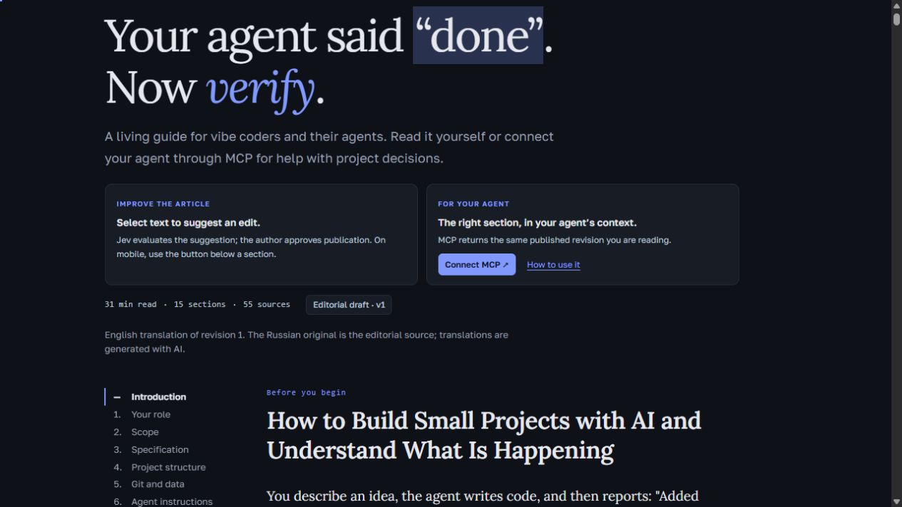

# The Living Handbook

A living article for beginner vibe coders — and an MCP server their agents can read. Suggestions go through probabilistic Jev evaluation, coherent rewriting and explicit human publication.

**[Live demo](https://the-living-handbook.fit-hake-0747.chatgpt.site/) · [Русский README](README.ru.md) · [Read the article](content/ARTICLE.en.md) · [Русская статья](content/ARTICLE.ru.md)**



## Why

An agent saying “refactored, optimized, added tests” does not explain whether a small project became better. The handbook helps beginners discuss concrete goals, risks and trade-offs while keeping the final decision with the person.

## What works

- A Russian/English article: introduction, 15 sections and 55 sources. Browser-language detection and manual switching.
- Selection-based suggestions, mobile/keyboard fallback, ChatGPT sign-in and draft restoration after sign-in.
- Jev via OpenRouter Decisions API; optional Claude Haiku 5.5 Writer; a separate Jev check of the candidate.
- Private author queue, Markdown editor, preview/comparison, explicit publication and rollback as a new revision.
- Read-only MCP tools: `get_article` and `get_section`, optional `language: ru | en` and pinned `revision_id`. Site and MCP read the same publication.
- A global four-new-suggestions-per-sliding-hour admission limit; overflow waits in FIFO without model calls. Quote/replacement: 1,500 characters each; reason: 500.
- Immutable source revisions/candidates, conflict detection, idempotent publication, encrypted API settings and a daily provider-call cap.

## Run locally

Node.js 22.14+ and npm are required; the current checks were run on Node 22.14.0.

```sh
npm ci
npm run check
npm run preview
```

Open http://127.0.0.1:3891/ and /admin. Preview uses a real local SQLite adapter and **injects a test author identity**. It does not load .env or configure paid providers. Runtime data stays in ignored .sites-runtime/. Never expose this preview adapter as a production server.

## Hosting and MCP

The live application runs as a Worker with D1 through **Sites**. Hosted identity headers, ChatGPT sign-in and the linked cloud schedule are platform integrations, not a self-contained OAuth implementation. See [deployment](docs/DEPLOYMENT.md), [MCP](docs/MCP.md) and [architecture](docs/ARCHITECTURE.md). The demo's /mcp endpoint may require separate Sites/OAuth authorization even though the article is public.

The original production project ID, database, keys, schedules and Git history are not included. Register your own Sites project and secrets. For another host, replace the identity and scheduler adapters first.

## Validation and limits

The check script builds the Worker and runs artifact validation, MCP/content smoke, editing, queue, locale and translation tests. Provider responses in automated tests are fixtures, not proof of live provider compatibility. The demo has produced a real 16-part English translation through the configured Writer. [The first GitHub CI run passed](https://github.com/Bb-soil/the-living-handbook/actions/runs/41513088580) on Linux/Node.js 22: clean installation and the full check suite.

Jev thresholds are provisional. The article is an editorial draft; its English version is AI-generated. Auto-publication is not implemented. A linked hourly cloud task is configured for the demo, but sustained unattended operation has not been independently established. External hosted MCP/OAuth connectivity and full D1 backup/restore remain verification tasks. Compact agent decision cards and the original automated source-selection pipeline are future work.

## Contribute and license

[Contributing](CONTRIBUTING.md) · [Roadmap](ROADMAP.md) · [Security boundaries](SECURITY.md) · [License scope](LICENSE_SCOPE.md).

The article and editorial content use CC BY 4.0. The application code uses [MIT](LICENSE); see LICENSE_SCOPE.md for the exact content/code boundary. References retain their own licenses.
